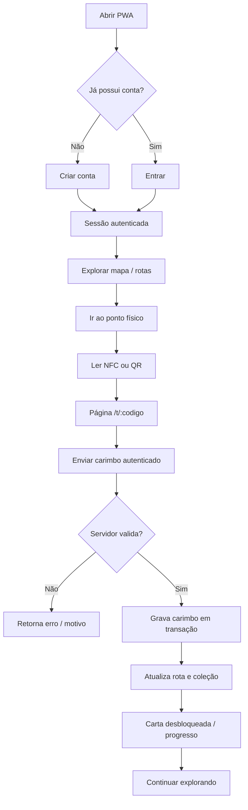
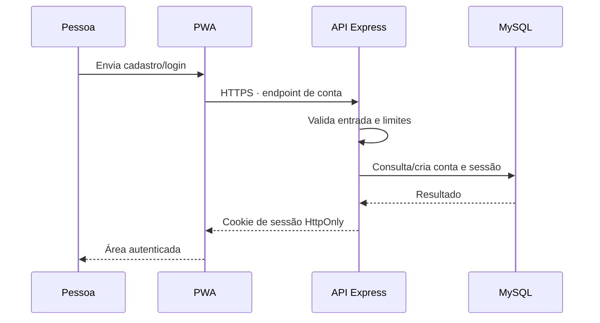
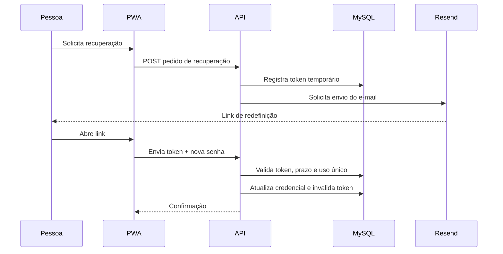
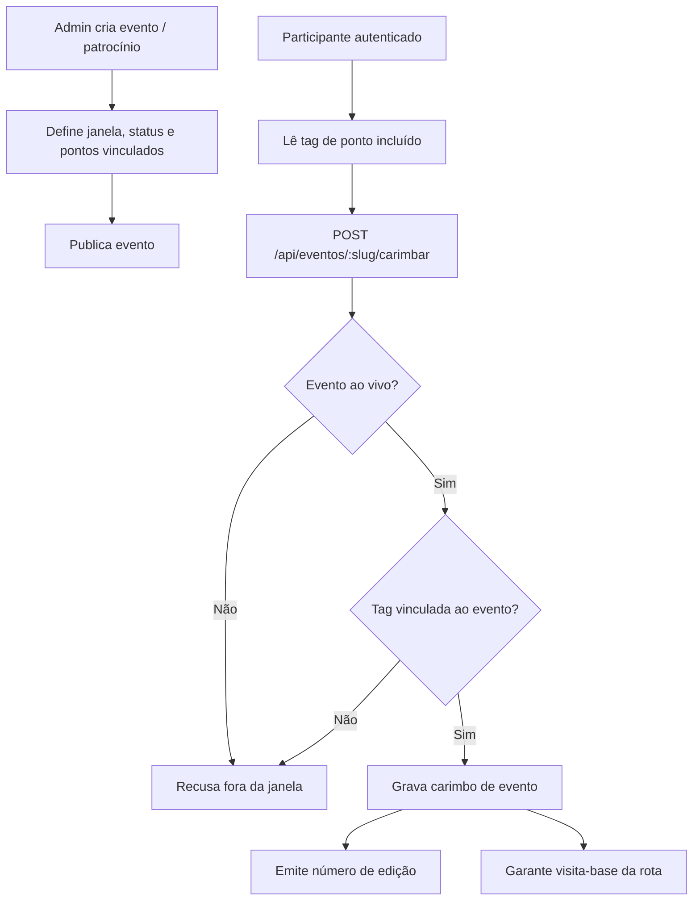
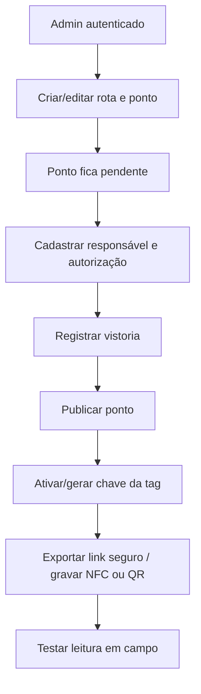
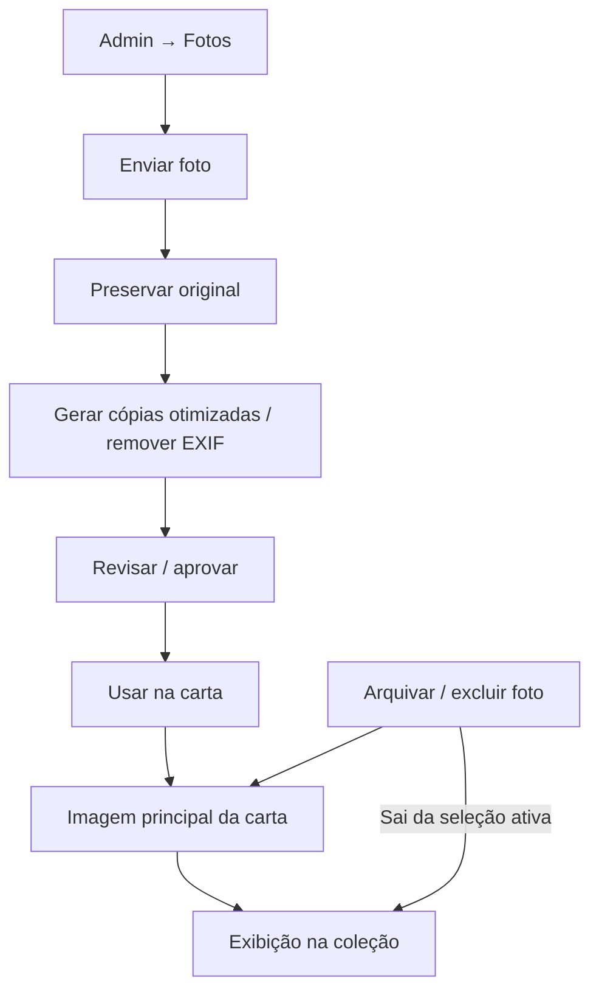

# Fluxos do sistema — KMkm / +1 KM

Este documento descreve os caminhos funcionais identificados no README, na API e nos módulos do servidor. É documentação técnica, não uma especificação de interface pixel a pixel.

## 1. Jornada principal do participante

### Validações do carimbo

1. Tag existe e ponto/rota estão publicados.
2. Chave do link `?k=` confere com o segredo configurado.
3. Geofence é avaliada apenas se o ponto/ambiente exigir localização.
4. Limite de ritmo é recalculado sob lock da conta, dentro da transação.
5. Repetição dentro da janela definida não cria um novo carimbo-base.
6. Deslocamento improvável e ritmo suspeito são sinalizados para revisão; a sinalização não equivale a prova de fraude.
7. Resultado inclui informações da rota, coleção/carta, contagem diária e, quando aplicável, dados de evento.

**Limite importante:** uma tag NFC comum ou QR estático pode ser fotografado/copiar o link. Chave assinada dificulta adivinhação e permite revogação, mas não prova por si só que a pessoa esteve fisicamente no local.

## 2. Cadastro, login e sessão

- Senhas são derivadas com scrypt conforme a documentação.
- A sessão é baseada em cookie HttpOnly; atributos incluem SameSite e Secure em HTTPS.
- Operações que alteram dados devem respeitar verificação de origem e autorização.
- A recuperação usa token de uso único, com expiração curta, e envio pelo Resend quando configurado.
- Não registrar senha, token de redefinição, cookie ou hash sensível em logs.

## 3. Recuperação de senha

Dependências: `RESEND_API_KEY`, `RESEND_FROM`, `APP_PUBLIC_URL` e domínio verificado. Sem as variáveis válidas, não considerar a recuperação pronta em produção.

## 4. Eventos e patrocínios

## 5. Administração e publicação de pontos

A publicação deve exigir responsável, autorização e vistoria conforme `EXIGIR_AUTORIZACAO` (padrão true). Não publicar ponto sem permissão documentada e validação presencial das coordenadas.

## 6. Fotos e cartas

O original e os derivados têm papéis diferentes. A aprovação, o crédito, a autorização de uso e a política de exclusão devem seguir [midia.md](midia.md). A visualização ampliada e a miniatura também devem respeitar as regras de desbloqueio descritas no produto.

## 7. Exclusão de conta

O fluxo autenticado `DELETE /api/eu` remove os carimbos do usuário, sessões, conta associada e registro de usuário em transação, conforme o código atual. O usuário também dispõe da página pública `/excluir-conta` para instruções e contato. A operação deve ser testada com conta de teste antes de liberar produção.

## 8. Endpoints de referência

| Endpoint | Método | Finalidade |
|---|---|---|
| `/api/saude` | GET | Saúde do servidor e consulta ao banco |
| `/api/catalogo` | GET | Catálogo público |
| `/api/caderneta` | GET | Progresso, rotas, eventos e coleção do usuário |
| `/api/tags/:codigo/carimbar` | POST | Registrar carimbo de ponto |
| `/api/eventos/:slug/carimbar` | POST | Registrar carimbo de evento |
| `/api/gamificacao` | prefixo | Recursos de gamificação |
| `/api/admin` | prefixo | Recursos administrativos autenticados |
| `/api/eu` | DELETE | Excluir dados/conta do usuário autenticado |

A especificação OpenAPI em [docs/api/](api/README.md) é a referência contratual quando houver divergência.

## 9. Testes de ponta a ponta recomendados

- Cadastro → sair → login com mesma conta.
- Login em segundo aparelho e persistência correta da sessão.
- Tag publicada: leitura válida, chave inválida, tag despublicada e geofence habilitada/desabilitada.
- Duplo toque na mesma tag dentro e fora da janela de repetição.
- Tentativas simultâneas e limite de ritmo.
- Evento antes, durante e depois da janela; tag vinculada e não vinculada.
- Carta desbloqueada, foto aprovada, foto arquivada e acesso por usuário sem desbloqueio.
- Recuperação de senha: token expirado, usado, inválido e link aberto em outro aparelho.
- Exclusão de conta e conferência da remoção dos dados relacionados.
- Restauração de backup em banco isolado.

Os testes unitários existentes não substituem esta bateria E2E completa.
