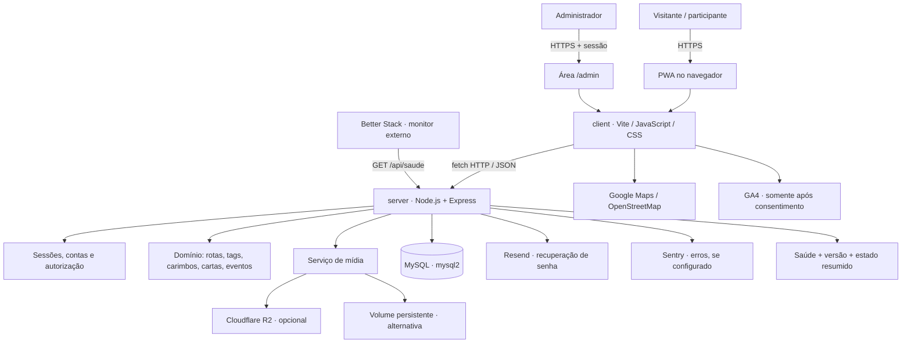
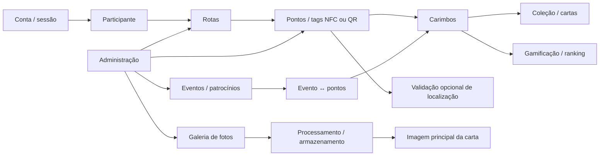
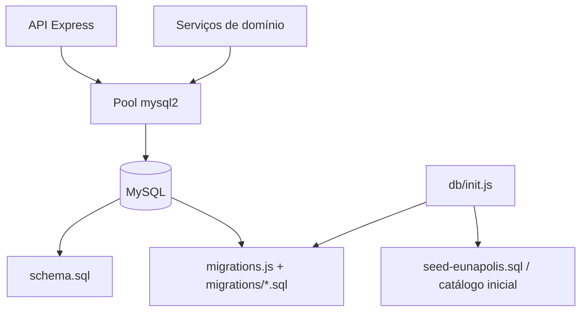
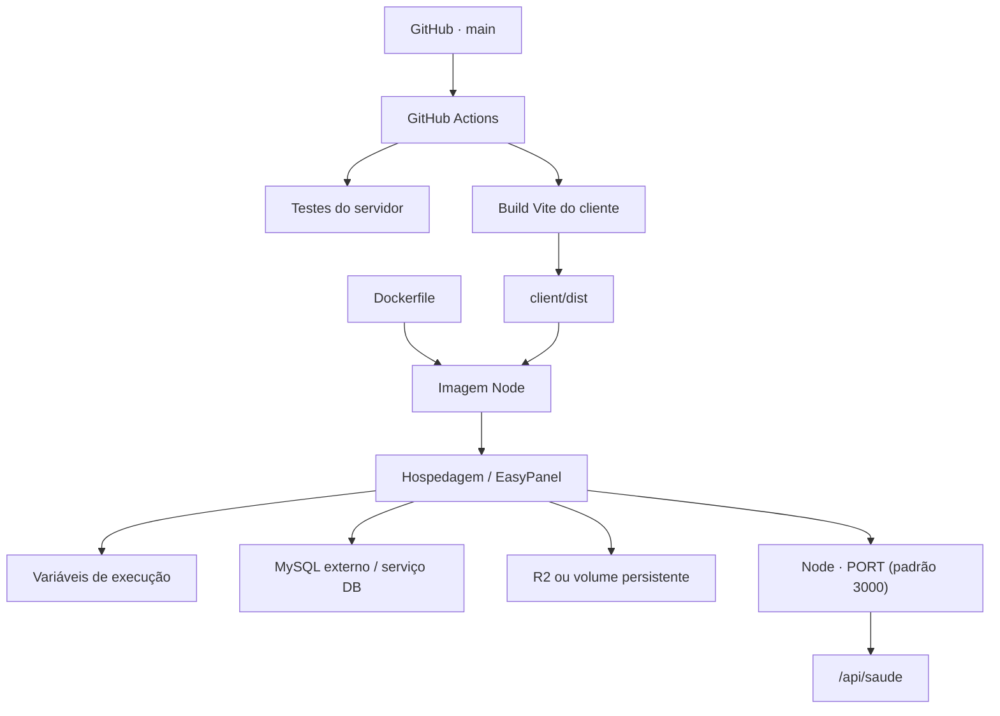

# Mapa de arquitetura técnica — KMkm / +1 KM

> Documento de referência da arquitetura identificável no código e na documentação versionados. Atualizado em 29/10/2026. Não representa uma inspeção do EasyPanel, dos valores reais de ambiente ou de recursos ativos na nuvem.

## 1. Visão geral

O produto é uma PWA mobile-first para experiências de turismo e coleta de carimbos em pontos físicos. O navegador executa o frontend; o mesmo servidor Node/Express entrega a API, páginas públicas e, em produção, os arquivos compilados do frontend. O MySQL é a persistência transacional. O armazenamento de mídia pode ser R2 ou diretório persistente.



**Leitura das conexões**
- Linhas contínuas representam relações arquiteturais descritas no código/documentação.
- R2, Resend, Sentry, Google Maps, GA4 e Better Stack dependem de configuração e disponibilidade externas; a presença no diagrama não prova que estejam ativos no ambiente de produção.
- O Google Maps tem alternativa OpenStreetMap. A localização do visitante é tratada no aparelho conforme o README; não se deve inferir armazenamento de coordenadas pessoais no servidor a partir do mapa.

## 2. Camadas e responsabilidades

| Camada | Local | Responsabilidade |
|---|---|---|
| Interface pública | `client/` | PWA, telas de mapa, rotas, perfil, coleção, cartas e eventos |
| Interface administrativa | `client/admin.html` e módulos do cliente | Gestão de pontos, fotos, conteúdo e operação |
| API / aplicação | `server/index.js` | Express, rotas HTTP, autenticação, regras de negócio e entrega do frontend compilado |
| Domínio | `server/` e `shared/` | Carimbos, gamificação, eventos, tags, relatórios e regras compartilhadas |
| Persistência | `server/db/` | Pool MySQL, inicialização, schema e migrações |
| Mídia | `server/midia/` | Processamento, armazenamento e rotas públicas/administrativas |
| Operação | `server/scripts/` | Administração, chaves de tags, pontos, mídia, smoke tests e relatórios |
| Qualidade | `server/test/`, `.github/workflows/ci.yml` | Testes automatizados e integração contínua |
| Documentação | `docs/`, `README.md`, `TODO.md` | Operação, segurança, API, piloto e decisões técnicas |

### Frontend

- Build: Vite (`npm run build` na raiz chama o build do cliente).
- Linguagem: JavaScript, HTML e CSS; o manifesto declara React/React DOM e plugin React, mas o README caracteriza a interface como JavaScript sem framework de UI. A utilização efetiva deve ser confirmada por imports, não apenas pelo manifesto.
- Mapa: Leaflet está declarado nas dependências; Google Maps é a integração documentada, com alternativa OpenStreetMap. Verificar os módulos de mapa para a implementação efetivamente carregada em cada tela.
- PWA: Service Worker, cache e arquivos públicos do cliente.
- Analytics: GA4 opcional, controlado por consentimento.

### Backend e persistência

- Node.js com módulos ES; Express 4.
- MySQL via `mysql2/promise`, pool com limite de 10 conexões e sessão SQL em UTC.
- Migrações e schema em `server/db/`.
- Processamento de imagem com Sharp.
- Integração S3-compatible via `aws4fetch` para R2.
- Monitoramento de erros com Sentry opcional.

## 3. Módulos de domínio



- **Conta e sessão:** contas por e-mail/senha; scrypt e cookie HttpOnly conforme documentação de segurança.
- **Tag e carimbo:** a rota `POST /api/tags/:codigo/carimbar` verifica existência/publicação, chave assinada, geofence quando exigida, limite de ritmo e repetição; grava em transação.
- **Evento:** `POST /api/eventos/:slug/carimbar` valida janela do evento, vínculo tag-evento e registra a visita-base da rota quando necessário.
- **Coleção:** `GET /api/caderneta` agrega rotas, pontos, carimbos, eventos e coleção.
- **Mídia:** originais e versões processadas têm ciclo de vida próprio; consulte [midia.md](midia.md) para regras de publicação, crédito e R2.
- **Administração:** rotas administrativas ficam sob `/api/admin` e exigem autenticação/autorização.

## 4. Dados e persistência

Entidades funcionais visíveis no código/schema incluem contas, sessões, usuários, rotas, tags, carimbos, eventos, vínculo evento-tag, patrocinadores e registros de mídia. A definição completa e autoritativa é o schema e as migrações em `server/db/`.



**Regras operacionais**
- Banco local via Docker Compose; produção usa a conexão definida em `DATABASE_URL`.
- Migrações são executadas na inicialização do servidor conforme implementação atual.
- Fazer backup não basta: a checklist exige restauração comprovada em banco de teste.
- Não há evidência nesta documentação de replicação, failover ou alta disponibilidade do banco; não assumir essas capacidades.

## 5. Integrações externas

| Integração | Finalidade | Configuração | Condição / ressalva |
|---|---|---|---|
| Google Maps | Mapa e geocodificação/renderização conforme módulo | `GOOGLE_MAPS_API_KEY`, opcional `GOOGLE_MAP_ID` | Restringir chave por domínio e API no Google Cloud |
| OpenStreetMap | Alternativa de mapa | Configuração do frontend | Alternativa documentada quando Google Maps não está disponível |
| Cloudflare R2 | Fotos e derivados | `R2_ACCOUNT_ID`, `R2_BUCKET`, `R2_ACCESS_KEY_ID`, `R2_SECRET_ACCESS_KEY` | Opcional; alternativa é `MEDIA_DIR` em volume persistente |
| Resend | E-mail de recuperação de senha | `RESEND_API_KEY`, `RESEND_FROM`, `APP_PUBLIC_URL` | Domínio remetente precisa estar verificado |
| Sentry | Erros de aplicação | `SENTRY_DSN`, opções de ambiente/traces | Desligado sem DSN |
| Better Stack | Monitoramento externo de disponibilidade | Monitor configurado no provedor | Consulta `GET /api/saude`; configuração da conta não é auditada aqui |
| Google Analytics 4 | Métricas de uso | `VITE_ANALYTICS_ENABLED`, `VITE_GA4_ID` | Só deve carregar após consentimento |

## 6. Build, deploy e execução



Comandos documentados na raiz:
```bash
npm run setup
docker compose up -d db
npm run db:init
npm run dev:server
npm run dev:client
npm run build
npm start
npm --prefix server test
``

O Dockerfile e o workflow são a fonte para os detalhes exatos da imagem e da pipeline. Não colocar segredos em build args; usar variáveis de execução no provedor.

## 7. Observabilidade

- `GET /api/saude`: verifica consulta simples ao MySQL e informa `ok`, `banco`, `versao`, estado resumido das chaves e tipo de armazenamento de mídia.
- `RELEASE_VERSION`: identifica a versão publicada; sem ela a API retorna `versao: "desconhecida"`.
- Sentry: captura erros quando `SENTRY_DSN` está configurado.
- Better Stack: monitor externo pode verificar saúde e página inicial.
- Logs estruturados incluem `request_id` em erros HTTP; não incluir segredos nem dados pessoais em logs.

## 8. Limites conhecidos e pontos a confirmar

1. Este mapa não executa análise estática de todos os imports nem instrumenta chamadas em runtime.
2. A configuração real do EasyPanel, MySQL, R2, Resend, Sentry, GA4, DNS e Better Stack não foi consultada.
3. Não há comprovação de backup/restauração recente nem de teste E2E completo apenas pela leitura do código.
4. O mecanismo de chave em tag NFC/QR não prova presença física contra cópia/fotografia do link; para prova forte de presença é necessária tag dinâmica compatível (ex.: NTAG 424 DNA) e validação específica, ainda não implementada conforme documentação de segurança.
5. O limite de tentativas em memória não é distribuído entre múltiplas instâncias.
6. A documentação de segurança registra pendências sobre cópia local do hash de senha e limpeza de contas anônimas.

## 9. Fontes internas

- [README](../README.md)
- [Checklist de deploy](DEPLOY-CHECKLIST.md)
- [Segurança](seguranca.md)
- [Mídia](midia.md)
- [API](api/README.md)
- [Riscos do piloto](riscos-piloto-eunapolis.md)
- [TODO](../TODO.md)
