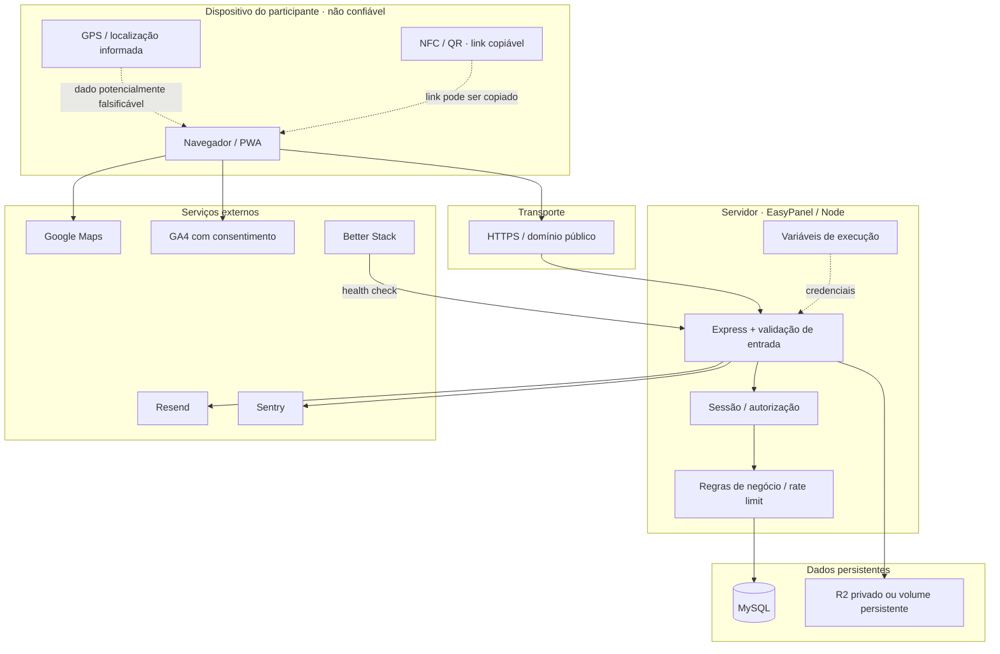
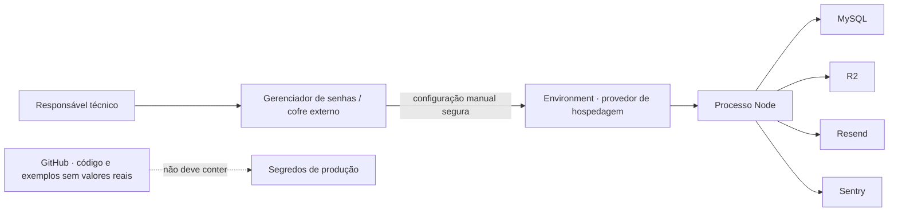

# Mapa de segurança e infraestrutura — KMkm / +1 KM

> Guia de fronteiras de confiança, segredos, controles e continuidade. Valores reais de produção não são exibidos nem auditados neste documento.

## 1. Fronteiras de confiança

**Princípio:** o cliente é controlado pelo usuário e não deve ser tratado como fonte confiável de identidade, localização, preço, autorização ou resultado de carimbo. Decisões e gravações críticas devem ser validadas no servidor.

## 2. Controles identificados

| Área | Controle documentado/identificado | Limite / risco residual |
|---|---|---|
| Transporte | HTTPS na publicação | Certificado, domínio e redirecionamento precisam ser verificados no provedor |
| Senhas | scrypt | Revisar parâmetros e política conforme evolução |
| Sessões | Cookie HttpOnly, SameSite e Secure em HTTPS | Testar expiração, revogação e uso em múltiplos dispositivos |
| CSRF/origem | Verificação de origem em pedidos que alteram dados | Revisar origens extras e domínios publicados |
| CSP | Política de segurança de conteúdo | `CSP_LEGADO=true` reduz proteção; evitar uso permanente |
| Rate limit | Limites por rota/IP/conta conforme middleware | Documentado como memória local: não distribuído e reinicia com processo |
| NFC/QR | Chave assinada `?k=`, revogável por rotação | QR/link pode ser fotografado ou compartilhado |
| Geofence | Raio opcional por ponto | GPS pode ser falsificado; coordenadas precisam ser validadas em campo |
| Banco | Consultas parametrizadas e transações em operações críticas | Backup/restore e acesso de rede precisam de verificação operacional |
| Mídia | R2 privado ou volume; derivados processados sem EXIF conforme documentação | Validar política de acesso, retenção, exclusão e recuperação |
| Erros | Sentry opcional e request_id | Conferir remoção de PII e segredos de contexto |
| Analytics | GA4 condicionado a consentimento | Validar tecnicamente ausência de chamadas antes do aceite |

## 3. Inventário de variáveis de ambiente

Nunca copie valores reais para este documento, issues, prints ou logs. Os nomes abaixo vêm dos arquivos de exemplo e da checklist versionada.

| Variável | Escopo | Classificação | Uso |
|---|---|---|---|
| `DATABASE_URL` | servidor | Segredo crítico | Credencial e endereço do MySQL |
| `TAG_KEY_SECRET` | servidor | Segredo crítico | Assinatura das chaves de links NFC/QR |
| `RESEND_API_KEY` | servidor | Segredo | Envio de e-mail |
| `R2_ACCESS_KEY_ID` / `R2_SECRET_ACCESS_KEY` | servidor | Segredo | Acesso ao bucket R2 |
| `SENTRY_DSN` | servidor | Configuração sensível | Ativação do monitoramento de erros |
| `RESEND_FROM` | servidor | Configuração | Remetente verificado |
| `APP_PUBLIC_URL` | servidor | Configuração | URL pública para links e recuperação |
| `GOOGLE_MAPS_API_KEY` | cliente/servidor conforme consumo | Chave de API | Mapa; restringir por domínio e API |
| `GOOGLE_MAP_ID` | cliente | Configuração | Estilo/identificador de mapa |
| `RELEASE_VERSION` | servidor | Configuração | Identificar versão em `/api/saude` |
| `SENTRY_ENVIRONMENT`, `SENTRY_TRACES_SAMPLE_RATE` | servidor | Configuração | Ambiente e amostragem |
| `R2_ACCOUNT_ID`, `R2_BUCKET`, `MEDIA_DIR` | servidor | Configuração | Localização do armazenamento de mídia |
| `PORT`, `APP_TZ` | servidor | Configuração | Porta e fuso de negócio |
| `GEOFENCE_RAIO_PADRAO_M`, `EXIGIR_AUTORIZACAO` | servidor | Configuração | Regras de publicação e localização |
| `CSP_LEGADO`, `FRAME_ANCESTORS`, `ORIGENS_PERMITIDAS`, `COOKIE_SAMESITE` | servidor | Segurança/configuração | Política web e cookies |
| `CONTATO_EMAIL` | servidor | Configuração | Contato nas páginas públicas |
| `VITE_ANALYTICS_ENABLED`, `VITE_GA4_ID` | build do cliente | Configuração pública | Analytics consentido |

**Importante:** variáveis `VITE_*` são incorporadas ao bundle do frontend e não podem conter segredos. `DATABASE_URL`, tokens, chaves privadas e segredos devem existir apenas no ambiente de execução do servidor.

## 4. Fluxo de segredos e permissões

- Manter cópia offline/segura de `TAG_KEY_SECRET` e credenciais críticas, com acesso mínimo.
- Rotacionar senha do MySQL e tokens em caso de exposição; atualizar serviço e aplicação em janela controlada.
- Não colocar credenciais em Docker build args, commits, logs, Postman compartilhado ou screenshots.
- Restringir a chave Google Maps por referenciador HTTP e API necessária.
- Token R2 deve ter escopo mínimo no bucket necessário.
- Separar credenciais de desenvolvimento, teste e produção.

## 5. Continuidade e recuperação

| Ativo | Rotina necessária | Evidência de sucesso |
|---|---|---|
| MySQL | Backup automático e retenção definida | Restauração testada em banco isolado, com contagens e integridade conferidas |
| Fotos | R2 ou volume persistente; política de retenção | Recuperar original e derivado de amostra |
| Chaves das tags | Backup seguro do `TAG_KEY_SECRET` | Validar uma tag de teste após restauração |
| Código | GitHub + CI | Commit e workflow identificáveis |
| Configuração | Inventário de nomes e procedimento de recuperação | Recriar serviço sem expor valores |
| E-mail | Domínio e API key Resend | Teste de recuperação em conta de teste |
| Observabilidade | Sentry e Better Stack quando habilitados | Alerta de teste recebido e health check verde |

## 6. Checklist de segurança antes do piloto

- [ ] Rotacionar qualquer senha/token que tenha aparecido em log, build ou repositório.
- [ ] Confirmar que segredos estão apenas nas variáveis de execução.
- [ ] Confirmar `TAG_KEY_SECRET` persistente e backup seguro; testar rotação em uma tag de teste.
- [ ] Restringir Google Maps API Key por domínio e API.
- [ ] Confirmar banco não exposto publicamente e usuário MySQL com privilégios mínimos.
- [ ] Fazer backup e restaurar em ambiente isolado.
- [ ] Confirmar mídia em R2 privado ou volume persistente e testar recuperação.
- [ ] Confirmar `RELEASE_VERSION` diferente de `desconhecida`.
- [ ] Verificar `/api/saude`, login, logout e autorização administrativa.
- [ ] Verificar recuperação de senha em segundo aparelho.
- [ ] Confirmar GA4 não envia dados antes do consentimento.
- [ ] Testar CSP sem ativar modo legado.
- [ ] Executar os testes automatizados e smoke tests de API.
- [ ] Fazer fluxo real supervisionado: conta → ponto → tag → carimbo → carta → segundo dispositivo.

## 7. Resposta a incidentes

1. **Vazamento de credencial:** revogar/rotacionar a credencial no provedor; atualizar ambiente; redeploy; revisar logs de acesso.
2. **Suspeita de tag clonada:** despublicar ponto temporariamente, girar chave, regravar a tag/QR e revisar carimbos suspeitos.
3. **Falha ou corrupção do banco:** suspender operações que possam ampliar dano; preservar logs; restaurar backup em ambiente isolado; validar antes de trocar produção.
4. **Mídia indisponível:** verificar estado R2/volume, permissões e configuração; não apagar originais para corrigir derivados.
5. **Indisponibilidade:** consultar `/api/saude`, logs com `request_id`, Sentry e monitor externo.

## 8. O que ainda precisa de confirmação operacional

- Estado real das variáveis no EasyPanel e ausência de segredos em Build Args.
- Política e evidência de backup automático do MySQL.
- Última restauração bem-sucedida e RPO/RTO pretendidos.
- Permissões de rede do MySQL e permissões do bucket R2.
- Estado real de Sentry, Resend, Better Stack, DNS e Google Maps.
- Proteção de branch `main`, aprovação obrigatória e exigência de CI.
- Teste E2E completo em dispositivos reais.

Consulte também [DEPLOY-CHECKLIST](DEPLOY-CHECKLIST.md), [seguranca](seguranca.md) e [riscos-piloto-eunapolis](riscos-piloto-eunapolis.md).
