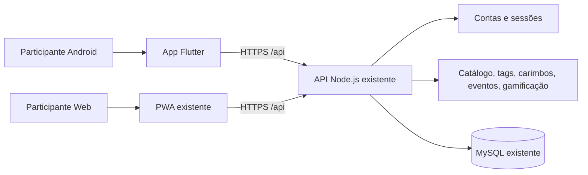

# Arquitetura proposta do cliente Android — Mais1km

**Status:** autenticação, catálogo/circuitos e mapa nativo inicial implementados; caderneta e demais jornadas ainda pendentes.
**Regra central:** o servidor existente é a fonte da verdade para conta, catálogo, carimbo, evento, coleção e gamificação.

## Visão lógica

O aplicativo e a PWA compartilham o mesmo serviço de API e o mesmo MySQL. Não criar outro domínio, serviço, banco ou volume para o Android. O app não acessa MySQL diretamente nem replica regras de negócio.

## Camadas implementadas

- **App:** entry point, tema visual, tela de autenticação e área inicial autenticada.
- **Core API:** cliente HTTPS com `dart:io HttpClient`, timeout e tratamento de rede/HTTP.
- **Core auth:** cookie de sessão protegido por `flutter_secure_storage`, restauração remota e logout.
- **Features:** login, cadastro, solicitação de recuperação, catálogo público, busca/filtro, detalhe básico e mapa nativo com marcadores.
- **Storage:** somente sessão. Sem SQLite/Drift ou progresso offline.

## Próximas camadas

- Caderneta, carimbos, eventos, gamificação e perfil. O catálogo/circuitos são lidos pela API e o mapa usa o proxy de tiles existente.
- Leitor NFC/QR e Android App Links após verificar o contrato de links.
- Redefinição por token/deep link após confirmar o formato do e-mail.
- Prova real do ciclo de sessão em aparelho Android.

## API e segurança

- Base URL: `https://mais1km.novaagencian8n.online`.
- Rotas com prefixo `/api`.
- O backend não retorna token Bearer no JSON de login/cadastro.
- Não registrar senha, cookie, chave NFC, token de redefinição ou coordenadas.
- Operações de escrita afetam dados compartilhados com o site; usar apenas contas/pontos autorizados.
- Catálogo: filtrar status publicado e oculto false; não presumir que toda resposta de /api/catalogo esteja pronta para exibição.
- Nenhum carimbo offline; somente o servidor confirma uma visita.

## Build e CI

O workflow `.github/workflows/mobile.yml` executa `flutter pub get`, `flutter analyze --fatal-infos`, `flutter test` e build APK debug. A execução da CI deve ser acompanhada após o PR.
