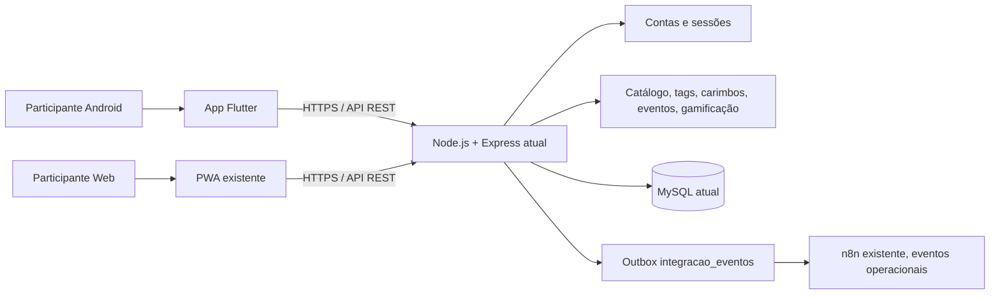

# Arquitetura proposta do cliente Android — Mais1km

**Status:** arquitetura inicial para validação; ainda não há código Flutter no repositório (atualizado em 2026-11-02).
**Regra central:** o servidor existente é a fonte da verdade para conta, catálogo, carimbo, evento, coleção e gamificação.

## Visão lógica

O app não acessa MySQL diretamente, não possui regras próprias de validação do carimbo e não usa a fila n8n como sistema analítico.

## Camadas Flutter a implementar progressivamente

- **App:** entry point, theme, navegação e tratamento global de erros.
- **Core API:** base URL por configuração segura de build/ambiente, cliente HTTP, JSON tipado, timeout, erros e captura de `X-Request-Id`.
- **Core auth:** cookie/session client depois de prova de conceito; estado autenticado derivado da API, não só de armazenamento local.
- **Features:** auth, home, map/catalog, points, routes, stamps, collection, events, gamification e profile.
- **Shared:** componentes visuais comuns depois de surgirem usos reais; evitar diretórios e abstrações vazias.
- **Storage:** armazenamento seguro apenas da sessão, caso o método aprovado exija. Sem cache de dados offline ou banco local no primeiro corte.

Riverpod é uma opção de estado sugerida, não uma decisão ainda validada. Selecionar uma única estratégia com base na toolchain/dependências instaladas; Flutter/Dart não existem nesta máquina nesta auditoria.

## Integração de autenticação

A API já emite cookie `HttpOnly` de conta e aceita token no header Bearer. O fluxo de conta não retorna token no JSON. A hipótese inicial é um cliente nativo com cookie jar persistente e armazenamento seguro; o comportamento precisa ser provado com Flutter antes de criar telas autenticadas.

Não retornar token Bearer a qualquer execução do frontend web sem análise de segurança. Se cookie jar não for adequado, desenhar e aprovar um fluxo mobile distinto de emissão/revogação de token. Nenhuma alteração de autenticação/backend foi feita nesta fase.

## Catálogo, mapas e mídia

- `GET /api/catalogo` é fonte dos pontos/circuitos. Resposta pode conter pontos não publicados/ocultos; o app precisa aplicar visibilidade conforme regras confirmadas.
- A PWA usa Google Maps quando há chave pública/configuração compatível; tem alternativa Leaflet/OpenStreetMap e endpoint proxy de tiles OSM. Isso não prova que exista um provedor nativo Android ativo.
- Provedor nativo de mapa fica pendente de ADR/prova de conceito com custo, atribuição/licença, restrição de chaves e compatibilidade com catálogo.
- Fotos públicas aprovadas vêm de `/api/pontos/:codigo/imagens` e URLs públicas de mídia; manter fallback sem imagem.

## NFC/QR e geolocalização

- A tag hoje abre uma URL web `/t/:codigo?k=...`; não há leitor NFC nativo Flutter existente.
- Estratégia futura preferida é verificar Android App Links para o mesmo domínio, mantendo navegador/PWA como fallback, e preservar o formato atual de tag até teste de campo e autorização.
- Chave de tag deve ser tratada como dado sensível de curta duração; não a registrar em log/analytics.
- GPS é solicitado sob demanda. Enviar somente `pos: { lat, lng, acc }` no pedido de carimbo que realmente exige localização; servidor calcula raio/precisão.
- Sem location background, sensores, bateria ou identificadores permanentes no MVP.

## Offline e telemetria

- O MVP é online para confirmação de carimbo. Sem SQLite/Drift e sem fila offline.
- Uma fila futura requer idempotency key e comportamento explícito no backend; não basta persistir uma requisição local.
- Telemetria própria está fora do app básico. Primeiro definir matriz de finalidade, dados, base legal avaliada, retenção, acesso, opt-out e exclusão.
- GA4 do web é opcional e condicionado a consentimento; não foi encontrado endpoint de telemetria móvel próprio.

## Build, operação e segurança

- Domínio da PWA informado pelo responsável: `mais1km.novaagencian8n.online` (grafia confirmada; ainda não verificado/testado por esta documentação). `applicationId` proposto: `online.navaagencian8n.mais1km` — mudar só antes da primeira publicação. Assinatura e fingerprints de release ainda não existem e não devem ir ao Git.
- Não gerar `assetlinks.json`, chaves de assinatura, release AAB ou publicar app até que identificadores e conta de publicação sejam confirmados.
- CI no GitHub Actions (desde 2026-11-02): `api.yml` (testes do server) e `pwa.yml` (build do client), ambos em Node 20 e independentes. O `ci.yml` combinado foi removido. O workflow Android será adicionado quando existir `mobile/pubspec.yaml`; o scaffold é gerado pelo workflow manual `mobile-scaffold.yml`, que publica a branch `feature/mobile-scaffold` sem alterar a `main`. Builds Flutter rodam nos servidores do GitHub, não na VPS.
- Nenhum staging/produção foi acessado. Testes de API com alteração de dados devem usar banco local ou staging autorizado.

## Bloqueios técnicos atuais

1. Flutter e Android SDK existem na VPS (`/opt/flutter`, `/opt/android-sdk`), mas não no ambiente de auditoria; a prova de cookie jar ainda não foi executada e `mobile/` ainda não existe.
2. Falta URL de homologação separada e conta de teste para a prova de autenticação (não testar contra produção); assinatura e fingerprints não existem.
3. A escolha de SDK/plugin de mapa nativo ainda não foi feita.
4. A matriz de privacidade para telemetria não está aprovada; por isso não implementar ingestão/persistência analítica.
5. (Resolvido na Fase 1) OpenAPI atualizado para os corpos de carimbo; ver `02-mapa-api.md`.
